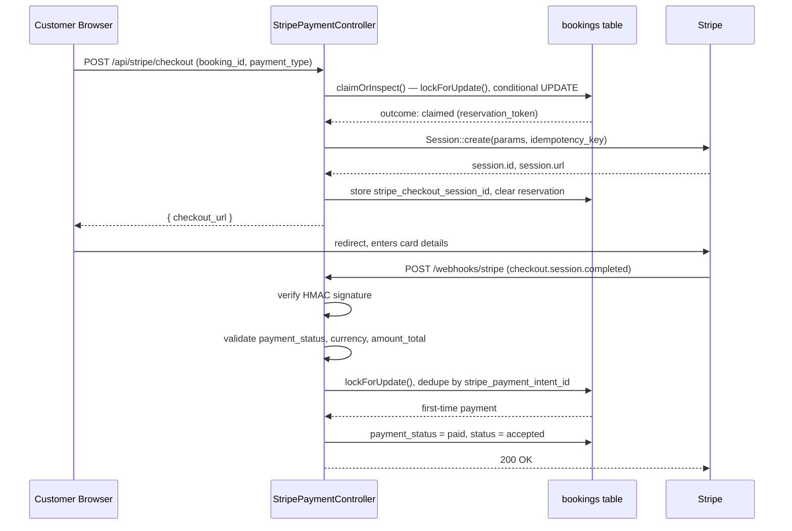

# Architecture Notes

Technical deep-dive on the payment system and a couple of other engineering
decisions that are easier to explain with room to breathe than as README
bullets. See [README.md](./README.md) for the feature overview and setup
instructions.

---

## Payment Flow Overview

Payments go through **Stripe Checkout** (redirect-based) rather than a
custom card form, so card data never touches the app's server. The flow:

1. **Customer selects a payment type** (20% downpayment or full amount) on
   Step 5 of the booking wizard.
2. **Server atomically reserves the right to create a session**
   (`StripePaymentController::claimOrInspect()`) before any Stripe call is
   made — see [Checkout Session Reservation](#checkout-session-reservation)
   below. This is what prevents two concurrent requests for the same
   booking from both reaching Stripe.
3. **Server creates a Checkout Session** (`createSessionForReservation()`),
   pricing it from `ServiceVariant->price` — never a client-supplied amount —
   and stamping the `booking_id` and `payment_type` into the session's
   `metadata`. The session is set to expire after 30 minutes (Stripe's
   minimum allowed window).
4. **Customer is redirected to Stripe** to enter card details and pay.
5. **Stripe redirects back** to `PaymentSuccess.jsx`, which polls booking
   status — but the redirect is *not* what confirms the booking. A closed
   tab or a flaky connection on the way back must not leave a paid booking
   stuck as unpaid.
6. **Stripe sends a `checkout.session.completed` webhook** to
   `/webhooks/stripe`, server-to-server, once payment actually clears. The
   handler validates it in full (see [Webhook Security](#webhook-security))
   before this is treated as the trigger that marks the booking `paid`.
7. **The polling page picks up the status change** and shows the
   confirmation screen.

Confirmation is deliberately decoupled from the browser redirect.



---

## Checkout Session Reservation

Creating a Stripe Checkout Session is an external HTTP call — it cannot
safely happen *inside* a database transaction (holding a row lock across a
slow or failed network call would block every other request touching that
row, including the webhook handler). But without some form of
coordination, two near-simultaneous requests for the same booking (a
double-click, a retried fetch after a timeout) could each independently
call `Session::create()` and produce two live checkout sessions for one
booking.

The fix is a short-lived **reservation**, stored directly on the booking
row (`checkout_reservation_token`, `checkout_reservation_expires_at` —
both nullable), claimed under a row lock *before* any Stripe call, and
released immediately after:

```php
// claimOrInspect() — runs inside DB::transaction(), lockForUpdate()
$updated = Booking::where('id', $locked->id)
    ->where(function ($q) {
        $q->whereNull('checkout_reservation_token')
          ->orWhere('checkout_reservation_expires_at', '<=', now());
    })
    ->where(function ($q) use ($expectedExpiredId) {
        $expectedExpiredId === null
            ? $q->whereNull('stripe_checkout_session_id')
            : $q->where('stripe_checkout_session_id', $expectedExpiredId);
    })
    ->update([
        'checkout_reservation_token'      => $token,
        'checkout_reservation_expires_at' => now()->addSeconds($ttl),
        'stripe_checkout_session_id'      => null,
    ]);
```

`claimOrInspect()` returns one of five outcomes, each handled explicitly
by `createCheckoutSession()`:

| Outcome | Meaning | Response |
|---|---|---|
| `claimed` | No live session or reservation existed — this request now exclusively owns the right to call Stripe | proceeds to `createSessionForReservation()` |
| `held_by_other` | A different request's reservation is still within its TTL | `409`, "please retry in a few seconds" |
| `has_session` | An `open` or `complete` Stripe session already exists | reuses the existing URL, or reports the booking as already processing |
| `retry` | The row changed between read and write (a concurrent request won the race) | re-evaluates from scratch, bounded to 3 attempts |
| `ineligible` | The booking is already paid or in a terminal status | `422` — never hands a fresh Stripe obligation to a dead booking |

The lock itself (`lockForUpdate()`) is held only for the duration of this
one read-decide-write step — a few milliseconds of local database work —
and is always released *before* `Session::create()` is ever called.
Holding a row lock across an external HTTP call would mean a slow Stripe
response (or a network partition) blocks every other operation on that
row, including the webhook handler that needs to mark it paid; this
design makes that scenario structurally impossible rather than merely
unlikely.

A reservation's TTL (`STRIPE_CHECKOUT_RESERVATION_TTL`, default 60
seconds, in `config('services.stripe.checkout_reservation_ttl')`) exists
to recover from a request that claimed the reservation and then genuinely
died before reaching Stripe (a crashed worker, a killed request) — after
the TTL expires, a new request is free to reclaim the slot. Residual
uncertainty from this is discussed in
[Known Limitations](#known-limitations).

An `open` existing session found via `has_session` is reused outright — no
new reservation, no new session, just the existing checkout URL handed
back. A Stripe-confirmed `expired` session is reclaimed through the same
atomic mechanism (`$expectedExpiredId`), so two simultaneous retries
against the same expired session still serialize on the row lock and only
one can win the reclaim.

---

## Stripe Idempotency and Ambiguous Failure Handling

Every session-creation attempt is scoped to a **per-attempt idempotency
key**:

```php
$idempotencyKey = "checkout:{$booking->id}:{$token}";
```

`$token` is the reservation token claimed in the step above — a fresh one
is minted every time a genuinely new attempt is claimed, so this key never
collides with, or masks, a separate legitimate later attempt.

Stripe's SDK distinguishes two very different kinds of failure when
calling `Session::create()`:

- **`ApiErrorException`** — a *definitive* rejection (bad parameters, auth
  failure). Stripe received and processed the request; nothing was
  created. Safe to clear the reservation immediately
  (`clearReservationAndFail()`) so the customer can retry right away.
- **`ApiConnectionException`** — *ambiguous*. The request may or may not
  have reached Stripe; we genuinely don't know whether a session was
  created.

On the ambiguous case, the code retries **once, synchronously, with the
identical idempotency key**:

```php
try {
    $session = Session::create($params, ['idempotency_key' => $idempotencyKey]);
} catch (ApiConnectionException $e) {
    try {
        $session = Session::create($params, ['idempotency_key' => $idempotencyKey]);
    } catch (ApiConnectionException $e2) {
        // still ambiguous after a same-key retry — flag, don't guess
    } catch (ApiErrorException $e2) {
        // a DEFINITIVE rejection under the SAME key means the original
        // attempt never went through either — safe to clear
    }
}
```

Because both attempts share the same idempotency key, Stripe's own
guarantee means this retry either safely returns the *same* session (if
the first attempt actually succeeded) or safely creates it fresh (if it
never arrived) — the ambiguity is resolved by Stripe's own deduplication,
not by application-level guesswork.

If the retry is **also** an `ApiConnectionException`, the system does not
assume either outcome. The reservation is deliberately left in place
(so no other request can mint a second, unrelated idempotency key for this
booking while the question is unresolved) and the incident is durably
flagged via `PaymentAnomalyService::record()` with kind
`unconfirmed_session_creation` — see
[Payment Anomaly Detection](#payment-anomaly-detection). The customer sees
a `503` asking them to wait and retry, not a silent assumption of safety.

---

## Webhook Security

The webhook endpoint is public (Stripe has to be able to reach it without a
session cookie), which means anyone could in principle POST a fake
`checkout.session.completed` payload claiming a booking was paid. This is
prevented with **HMAC signature verification**:

```php
$event = Webhook::constructEvent(
    $payload,
    $sigHeader,          // the "Stripe-Signature" header
    config('services.stripe.webhook_secret')
);
```

Stripe signs every webhook payload with a secret shared only between Stripe
and this app (`STRIPE_WEBHOOK_SECRET`, obtained via `stripe listen` locally
or the Stripe Dashboard in production). `Webhook::constructEvent` recomputes
the HMAC over the raw request body and compares it against the signature
header; if they don't match — or the payload was tampered with, replayed
with a stale timestamp, or simply forged — it throws
`SignatureVerificationException` and the handler returns `400` without
touching the database.

In plain terms: **the signature proves the request actually came from
Stripe and wasn't modified in transit** — necessary, but not sufficient on
its own, since a signed event can still carry a `payment_status` that
isn't actually `paid`, or money that doesn't match what the booking
expects. `handleCheckoutCompleted()` layers three further checks on top of
the signature before trusting the event:

```php
// The event TYPE firing isn't proof of payment on its own.
if (($session->payment_status ?? null) !== 'paid') {
    return response()->json(['status' => 'ok']); // ignored, not an error
}

$expectedAmountFils = (int) round(((float) $booking->downpayment_amount) * 100);

$amountOrCurrencyMismatch = ($session->currency ?? null) !== 'aed'
    || (int) ($session->amount_total ?? -1) !== $expectedAmountFils;
```

`$session->amount_total` and `$session->currency` are compared against the
booking's own persisted `downpayment_amount` — never trusted as-is. A
mismatch is never auto-confirmed; it's flagged (see
[Payment Anomaly Detection](#payment-anomaly-detection)) for manual review
instead.

---

## Webhook Redelivery and Payment Identity

Webhooks are "at-least-once" by design — Stripe retries delivery if it
doesn't get a fast `2xx`, so the same event can arrive more than once, and
a booking's `stripe_checkout_session_id` can legitimately point at a
*different* session than the one that actually ends up paid (an older
session completing after a newer one became "current" — see
[Redundant Session Reconciliation](#redundant-session-reconciliation)).
For this reason `handleCheckoutCompleted()` looks the booking up by `id`
alone, and uses **`stripe_payment_intent_id`** — not the session id, and
not the session's own `payment_status` field in isolation — as the one
stable, persisted identity for "has this exact payment already been
recorded":

```php
if ($locked->payment_status === 'paid') {
    if ($locked->stripe_payment_intent_id === $paymentIntentId) {
        // Ordinary redelivery of the SAME already-recorded payment —
        // no write, no flag, no audit event.
        return ['action' => 'duplicate_delivery'];
    }

    // A genuinely DIFFERENT successful payment. Never overwrite the
    // original paid_amount/payment_intent — flag for investigation.
    PaymentAnomalyService::record($locked, 'second_successful_payment', $paymentIntentId, [...]);
    return ['action' => 'flagged'];
}
```

An ordinary redelivery of a webhook for a payment already recorded is a
true no-op — not a double-charge, not a double-advance of booking status,
and not even a new audit log entry. A webhook reporting a **second,
genuinely different** successful `PaymentIntent` for an already-paid
booking is a materially different situation — it is never silently
accepted or merged into the existing record; it's flagged (see
[Payment Anomaly Detection](#payment-anomaly-detection)) and the original
financial fields (`paid_amount`, `stripe_payment_intent_id`) are left
untouched for manual review.

**A related race exists between two independent cancellation mechanisms
and a late payment confirmation.** A checkout session can be cancelled two
different ways (see [Abandoned Checkout Cleanup](#abandoned-checkout-cleanup)
below) while the *completed* event for that same session is still in
flight. Without a guard, a `completed` webhook arriving after the booking
was already cancelled would silently resurrect it as `accepted` — and
since real money may have actually been collected, simply ignoring the
event would be worse than resurrecting it. The handler does neither:

```php
// Money collected for a booking we've since cancelled must never be
// silently dropped, and must never resurrect it.
if ($locked->status === 'cancelled') {
    PaymentAnomalyService::record($locked, 'payment_for_cancelled_booking', $paymentIntentId, [...]);
    return ['action' => 'flagged'];
}
```

The payment is recorded as an anomaly requiring manual review — refund,
re-booking, or other resolution — rather than either silently keeping the
booking cancelled or silently reactivating it. The
`checkout.session.expired` handler has the mirror-image guard: it only
cancels a booking that's still `pending_payment`, so it can never clobber a
booking the `completed` event already marked `accepted`.

---

## Abandoned Checkout Cleanup

If a customer opens Stripe Checkout and just closes the tab, the booking
would otherwise sit in `pending_payment` forever, holding the therapist's
slot. Two independent mechanisms clean this up — deliberately redundant,
not duplicated by accident:

**1. Stripe-side session expiry (fast path).** The Checkout Session itself
is created with a 30-minute expiry — Stripe's shortest allowed window:

```php
// Stripe's minimum allowed expiry window is 30 minutes — shorter
// than the 24h default so an abandoned checkout frees the slot
// quickly instead of leaving the booking pending_payment all day.
'expires_at' => now()->addMinutes(30)->timestamp,
```

When the session expires, Stripe fires a `checkout.session.expired`
webhook, and the handler cancels the booking (if it's still
`pending_payment`) and frees the slot — normally within 30 minutes of
abandonment.

**2. Scheduled sweep, 20 minutes (safety net).** Webhooks can fail to
arrive — an outage, a dropped event, a checkout session the customer never
even opened. `bookings:expire-stale-pending-payment` runs on the scheduler
and force-cancels any `pending_payment` booking older than 20 minutes:

```php
// Safety net for when the checkout.session.expired webhook never fires
// (webhook downtime, missed event, or a checkout session that was never
// even opened). Threshold is shorter than Stripe's own session expiry
// so this rarely has to do the webhook's job, but still catches it
// within 20-30 min.
private const STALE_AFTER_MINUTES = 20;
```

The sweep's threshold (20 min) is intentionally *shorter* than Stripe's
session expiry (30 min), so in the common case the sweep is the one that
actually fires, and the webhook path is what rarely gets to do the work —
whichever one wins, the other is a no-op thanks to the idempotency guards
above.

---

## Payment Anomaly Detection

Several of the sections above describe situations that are deliberately
**never silently resolved**: an ambiguous Stripe connection failure that
survived a same-key retry, a second genuinely different successful
payment, a payment confirmed for a booking that's since been cancelled, or
a webhook's amount/currency not matching the booking's own record. All of
these converge on one shared, dedupe-safe recorder:

```php
PaymentAnomalyService::record(Booking $lockedBooking, string $kind, string $identity, array $details): void
```

**Caller contract:** `$lockedBooking` must already be loaded under an
active `lockForUpdate()` transaction on this booking's row — the service
itself calls Stripe for nothing and acquires no lock; it relies entirely
on the caller's existing lock to make the read-check-then-write atomic.
This is what prevents two concurrent or retried deliveries of the *same*
anomalous identity from producing two audit rows:

```php
$alreadyRecorded = AuditLog::where('event', 'payment.anomaly_detected')
    ->where('target_type', 'Booking')
    ->where('target_id', $lockedBooking->id)
    ->get()
    ->contains(fn ($row) => ($row->metadata['identity'] ?? null) === $identity);

if ($alreadyRecorded) return;
```

On a genuinely new anomaly, the service dispatches `DuplicatePaymentDetected`
(an `App\Events\Audit\*` event, routed through the existing
`AuditLogListener` into the `audit_logs` table under event
`payment.anomaly_detected` — visible today via the existing
**Admin → Audit Log** page, filtered on that event, with no new UI
required) and stamps `payment_anomaly_flagged_at` on the booking,
preserving the *first* time it was flagged rather than overwriting it on a
later, related anomaly:

```php
$lockedBooking->update([
    'payment_anomaly_flagged_at' => $lockedBooking->payment_anomaly_flagged_at ?? now(),
]);
```

**What this deliberately does *not* do:** flagged anomalies are not
automatically refunded, and the original financial record on the booking
(`paid_amount`, `stripe_payment_intent_id`) is never overwritten by the
anomaly path. Resolution — issuing a refund, reconciling a duplicate
charge in the Stripe Dashboard, or re-confirming a booking — is a manual
step for an operator reviewing the Audit Log, using the existing admin
refund tooling. The system's job here is to guarantee nothing anomalous is
ever silently absorbed into normal booking state, not to resolve it
unattended.

---

## Redundant Session Reconciliation

A booking's `stripe_checkout_session_id` reflects only the most recently
*created* session — but an older session, created before the one
currently referenced, can still legitimately be the one the customer
actually completes payment through (e.g. they had two tabs open, or a
retry created a second session before the first one's payment cleared).
When `handleCheckoutCompleted()` records a first legitimate payment, it
checks whether the session it just confirmed differs from whatever the
booking's pointer *was* before this update, and if so, queues cleanup
rather than doing it inline:

```php
if (!empty($outcome['previous_session_id']) && $outcome['previous_session_id'] !== $outcome['new_session_id']) {
    ReconcileRedundantCheckoutSession::dispatch(
        $booking->id,
        $outcome['previous_session_id'],
        $outcome['new_session_id'],
    );
}
```

`ReconcileRedundantCheckoutSession` is a `ShouldQueue` job — its Stripe API
calls run **outside any database lock**, on the queue worker process, not
inline in the webhook response. It retrieves the redundant session and
branches on its status:

- **`open`** — best-effort `Session::expire()`s it, so it can no longer be
  completed. If the expire call itself fails, the job cannot confirm the
  session is non-payable — rather than assume safety, it flags the
  incident via `PaymentAnomalyService` (kind `unconfirmed_expiry`).
- **`complete`** — a genuinely different successful payment, discovered
  through cleanup rather than its own webhook delivery. Flagged as
  `second_successful_payment`, same as the inline case in
  [Webhook Redelivery and Payment Identity](#webhook-redelivery-and-payment-identity).
- **`expired`** — already harmless; no action taken.

**Operational dependency:** this job only runs if a queue worker is
active. This project's `QUEUE_CONNECTION` is `database`, and the worker
(`php artisan queue:work`, included in the `composer dev` concurrent
process group) must be running for redundant sessions to actually get
cleaned up — see [Known Limitations](#known-limitations).

---

## Loyalty Voucher Cancellation Policy

Vouchers (`IHS-FREE-XXXX`, earned every 10 completed bookings) skip
payment entirely, so there's no refund to process on cancellation — but the
same fairness logic as a paid downpayment still applies, keyed off a 24
hour cutoff before the scheduled session:

- **Cancelled more than 24 hours before the session** → the voucher is
  restored to the customer's account and can be redeemed on a future
  booking.
- **Cancelled within 24 hours, or a no-show** → the voucher is forfeited
  permanently.

```php
$withinGrace = $hoursUntil > 24; // true = more than 24hrs away = restore

if ($booking->is_voucher_covered) {
    $voucherRestored = false;

    if ($withinGrace) {
        $restoreResult   = LoyaltyService::restoreVoucher($booking->id, $customerId);
        $voucherRestored = $restoreResult['success'];
    }

    $cancellationType = $voucherRestored ? 'refunded' : 'forfeited';
    // ...
}
```

This mirrors the paid-booking policy (20% downpayment forfeited within the
same 24-hour window) so customers face one consistent cancellation rule
regardless of how they paid.

---

## Booking Conflict Resolution

Double-booking prevention has to answer two *different* questions that are
easy to conflate:

- **Can the therapist do this?** — needs a travel-time buffer before the
  appointment and a rest buffer after, since the therapist is physically
  moving between locations.
- **Can the customer do this?** — only needs to avoid a genuine time
  overlap with the customer's *own* other bookings. The customer has no
  travel time to account for; they're just picking two sessions.

**The bug:** the original conflict check applied the therapist's
travel/rest buffer to the customer-side check too. That meant if a
*different* therapist had a rest buffer overlapping a time slot, a
customer's own next booking at that slot could be incorrectly blocked —
even though the customer wasn't double-booking anything and no travel was
involved on their side at all.

**The fix:** the customer-side conflict check now compares only against
the actual session window (`scheduled_start` / `scheduled_end`), ignoring
buffers entirely:

```php
// Customer-side conflict: compare only the actual session
// window (scheduled_start/scheduled_end) — no therapist
// travel/rest buffer applies to the customer's own schedule.
$customerConflict = Booking::where('customer_id', auth()->id())
    ->whereIn('status', ['pending_payment', 'pending', 'accepted'])
    ->where('scheduled_start', '<', $timeBlocks['scheduled_end'])
    ->where('scheduled_end',   '>', $slotDatetime)
    ->exists();
```

The therapist-side check (`hasConflict`) is untouched and still uses the
full travel-start-to-buffer-end window. The two checks now run
independently, so a customer can book back-to-back sessions the moment
their prior session ends, while therapist travel/rest constraints stay
fully enforced.

---

## Known Limitations

The mechanisms above are designed to make duplicate successful charges and
silently-lost payment state exceptionally unlikely, and to ensure that
when something genuinely ambiguous *does* happen, it is detected and
flagged rather than guessed at. They do not eliminate every risk, and the
remaining ones are recorded here deliberately rather than left implicit:

- **Ambiguous session creation after reservation TTL expiry.** If
  `Session::create()` fails with a connection error twice (see
  [Stripe Idempotency and Ambiguous Failure Handling](#stripe-idempotency-and-ambiguous-failure-handling))
  and the resulting anomaly is not manually investigated before the
  reservation's TTL lapses, there is no automated process that re-confirms
  whether a session actually exists under that idempotency key. The
  incident remains visible in the Audit Log, but recovery of an unknown
  Stripe session state is not guaranteed by the system itself.
- **No true multi-worker / production-load concurrency testing has been
  performed.** The reservation logic is covered by automated tests,
  including a genuine two-PostgreSQL-connection lock-contention test, but
  the system has not yet been exercised under real concurrent load across
  multiple application server processes in a production-equivalent
  environment.
- **Flagged anomalies require manual review.** `PaymentAnomalyService`
  records anomalies for an operator to act on; it does not issue refunds,
  reconcile Stripe Dashboard state, or resolve a `second_successful_payment`
  automatically. Monitoring the Audit Log is an operational responsibility,
  not an automated one.
- **`ReconcileRedundantCheckoutSession` depends on a running queue
  worker.** If the queue worker process is down, redundant open sessions
  are not proactively expired by this job — they still fall back to
  Stripe's own 30-minute `expires_at`, but the faster, explicit cleanup
  this job provides does not happen until the worker is running again.
- **Guest Booking eligibility enforcement is narrower than the
  authenticated booking flow.** `GuestBookingController::store()` validates
  only that the referenced service exists — not that it is active or
  unarchived — unlike the authenticated customer and therapist-facing
  booking paths, which independently re-check eligibility. This is a
  known, unresolved gap, not an oversight papered over by this
  documentation.
- **A narrow concurrent-admin-deactivation race remains.** The
  authenticated booking flow re-checks a service/variant's eligibility
  inside the same transaction that creates the booking, closing the
  realistic "admin deactivated it, then a booking request arrived"
  window — but no additional row lock was added on the `services`/
  `service_variants` tables themselves, so a theoretical same-instant race
  between an admin's deactivation and a booking's creation is not fully
  closed.
- **Uploaded service images are not part of version control.** Admin-
  uploaded photographs are stored on local disk (`storage/app/public`),
  which is gitignored. Deploying this application to a new environment
  requires independently provisioning persistent storage (and migrating or
  re-uploading existing images) for that feature to work — it is not
  carried by a `git push` or `git pull` alone.
